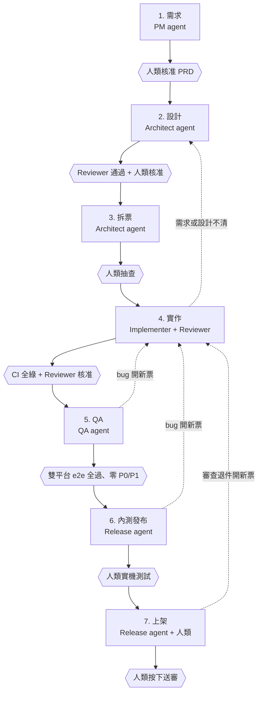
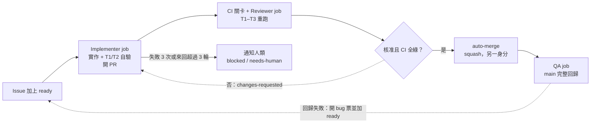

# Agent 端到端開發流程規範（雙平台行動 App）

> 本檔是 agent 遵循的流程依據（source of truth）。修改本檔視同修改流程，必須開票並由人類核准。

## 目的與範圍

本流程讓 agent 從需求到上架，端到端完成一個 iOS + Android 雙平台 App；人類只在少數幾道閘門核准，或處理 agent 無權處理的事。

- **適用**：任何以 agent 為主要開發者的行動 App 專案，與產品內容無關。
- **實驗目的**：驗證 agent 能否走完完整工程流程，並量化每個階段需要多少人類介入。
- **技術基線**：Expo（React Native + TypeScript）、Expo Router、EAS Build/Submit、Maestro e2e、GitHub（Issues + PR + Actions）。換技術棧時，流程不變，只替換各閘門的具體指令。
- **不在範圍內**：產品需求本身、視覺設計細節、商業與營運決策。

## 核心原則

每一步都必須能讓機器驗證；無法驗證的產出，視為未完成。

1. **只靠檔案交接**：階段之間、agent 之間只透過 repo 裡的檔案交接（spec、ADR、票、測試、PR），不依賴對話記憶。換一個新的 agent，讀完檔案就要能接手。
2. **驗收標準就是測試**：每條驗收標準以 Given/When/Then 撰寫，並對應到至少一個自動化測試。沒有測試的需求，視為未定義。
3. **寫的人與審的人隔離 context**：Reviewer 用全新的 context（最好換模型），只看票、diff 和測試結果。
4. **可測性優先於便利性**：外部依賴（定位、感測器、時間、網路、付款）一律經過 port 介面，提供可回放的 fake 實作，讓 e2e 測試結果確定。範例見 `packages/core/src/ports/clock.ts` 與 `apps/mobile/src/services/registry.ts`。
5. **小步、可回滾**：一張票一個 PR，每個 PR 都能獨立合併、獨立還原。
6. **人類只守閘門**：人類不參與日常實作，只在指定閘門核准，並處理帳號、金鑰、送審等 agent 無權處理的事。
7. **先打通管線，再加功能**：第一個垂直切片就要走完 CI → 雙平台 e2e → 內測版發布的完整路徑。

## 流程總覽

階段 4 與 5 的閘門全部自動化，是 agent 自主循環的主體；其餘五道閘門由人類把關。

## 角色定義

角色是權限邊界，不是人數：同一個模型可以分別擔任不同角色，但每次都要用新的 session 與對應的 skill（`.claude/skills/<role>/SKILL.md`）。

| 角色 | Skill | 職責 | 主要產出 | 可以做 | 不可以做 |
| --- | --- | --- | --- | --- | --- |
| PM agent | `pm` | 將產品構想轉成需求與驗收標準 | `docs/prd.md` | 澄清問題、定優先序 | 寫程式碼、自行核准範圍 |
| Architect agent | `architect` | 模組邊界、介面、技術決策、拆票 | `docs/adr/`、`docs/design/`、GitHub Issues | 拆票、定義介面、開契約票 | 實作功能票 |
| Implementer agent | `implement` | 一次完成一張票 | 分支、程式碼、測試、PR | 修改票上列出的檔案範圍 | 動票外檔案、改 CI 設定、自行合併 |
| Reviewer agent | `review` | 審查 PR 是否符合票與規範 | review findings | 要求修改、核准 | 修改程式碼 |
| QA agent | `qa` | 維護 e2e 與回歸測試、回報 bug | `e2e/maestro/`、`fixtures/`、bug 票 | 新增測試、開 bug 票 | 修改產品程式碼 |
| Release agent | `release` | 產生 build、商店素材、release notes | EAS build、截圖、metadata | 發布到內測軌道 | 送審、觸碰正式版金鑰 |
| 人類 Owner | — | 守閘門、處理帳號與實機測試 | 核准紀錄 | 所有事 | — |

## 各階段細則

每個階段都以「完成定義」結束；未達成就不能進入下一階段。

| 階段 | 執行者 | 輸入 | 產出 | 完成定義 | 閘門 |
| --- | --- | --- | --- | --- | --- |
| 1. 需求 | PM agent | 人類的產品構想 | `docs/prd.md`、user stories、非功能需求 | 每個 story 都有 Given/When/Then；MVP 範圍與「不做清單」都已寫明 | 人類核准 PRD |
| 2. 設計 | Architect agent | 已核准的 PRD | ADR、領域模型、模組與介面、畫面流程、design tokens | 每個外部依賴都有 port 與 fake；技術選型都有 ADR | Reviewer agent 通過後，人類核准 |
| 3. 拆票 | Architect agent | 設計文件 | GitHub Issues（依票的格式）、依賴關係 | 每張票 ≤ 1 個 PR，列明檔案範圍與驗收測試 | 人類抽查 |
| 4. 實作 | Implementer agent | 一張票 | 分支、程式碼、測試、PR | 本機驗證全綠；PR 範本填寫完整 | CI 全綠，且 Reviewer agent 核准 |
| 5. QA | QA agent | main 的最新版 | 完整回歸報告、bug 票、截圖基準 | 所有 story 的 e2e 在雙平台都通過 | 零個 P0/P1 bug |
| 6. 內測發布 | Release agent | QA 通過的 commit | TestFlight / Play 內部測試版、release notes | 兩個平台的內測版都可安裝 | 人類實機測試通過 |
| 7. 上架 | Release agent + 人類 | 已通過實機測試的版本 | 商店 metadata、截圖、隱私聲明草稿 | 素材齊備，審查清單全部打勾 | 人類按下送審 |

審查被退回、或實機測試發現問題時，一律開成新票，回到階段 4；資訊不夠就回到階段 1 或 2，不在實作中自行補需求。

## Ticket 與 PR 規範

一張票對應一個分支、一個 worktree、一個 PR；票沒寫的事，Implementer 不做。

- 票的格式：`.github/ISSUE_TEMPLATE/ticket.md`
- PR 範本：`.github/pull_request_template.md`
- 分支命名：`<type>/<issue號>-<slug>`，例如 `feat/12-session-list`。
- Commit 採用 Conventional Commits，訊息帶票號。
- main 受保護；只接受 squash merge，禁止 force push。

**平行開發規則**

- 只有檔案範圍不重疊的票可以同時進行。
- 共用介面、資料庫 schema、導覽結構的變更，只能由 Architect 開的「契約票」（label `contract`）修改，並且先合併。
- 同時進行的 Implementer 上限為 3 個，可視 Reviewer 的產能調整。

## Agent 協作機制

Agent 之間不直接對話，而是以 GitHub 的 issue、label 與 PR 狀態接力；GitHub 是唯一的 source of truth。

| 層 | 負責 | 使用 |
| --- | --- | --- |
| 狀態與溝通 | 誰該做什麼、做到哪、交接內容 | GitHub Issues、labels、PR、review comments |
| 調度 | 狀態一變，就啟動對應角色的 agent | GitHub Actions 事件觸發，以 headless Claude Code 執行 |
| 執行與觀察 | agent session 跑在哪裡、人如何介入 | 階段 4–5：CI runner；階段 1–3 與除錯：本機多 agent 工具或 Claude Code desktop |

**Label 狀態機**（以 `scripts/setup-labels.sh` 建立）

| Label | 意義 | 誰可以加 | 觸發 |
| --- | --- | --- | --- |
| `ready` | 票已可開始實作 | 人類、Architect bot；QA bot 僅限有重現步驟的 P0/P1 bug | 啟動 Implementer |
| `in-progress` | Implementer 正在實作 | Implementer | — |
| `in-review` | PR 已開，等待審查 | Implementer | 啟動 Reviewer（由 PR 事件觸發） |
| `changes-requested` | Reviewer 要求修改 | Reviewer | 再次啟動 Implementer，輪數 +1 |
| `blocked` | 同一個問題失敗 3 次 | Implementer | 通知人類 |
| `needs-spec` / `needs-design` | 需求或設計不清 | 任何 agent | 退回 PM 或 Architect |
| `needs-human` | review 來回超過 3 輪，或需要人類裁決 | 任何 agent | 通知人類，暫停自動化 |

由一個 agent 操作另一個 agent 的 session，只在除錯時使用。

## 驗證與品質閘門

PR 要合併，必須同時滿足：下列 CI 關卡全部通過，且 Reviewer agent 核准。關卡不穩定（flaky）時要修正關卡本身，不能重跑到綠燈為止。

| 層級 | 工具 | 跑在 | 觸發時機 | 失敗時 |
| --- | --- | --- | --- | --- |
| 靜態檢查 | `tsc --noEmit`、ESLint（`expo lint`）、Prettier | 本機 hook + CI | 每次 agent 結束回合、每個 PR | 擋合併 |
| 單元測試 | Vitest（`packages/core`，純 TS 領域邏輯） | 本機 hook + CI | 每個 PR | 擋合併；核心模組覆蓋率 ≥ 80% |
| 元件測試 | Jest（jest-expo）+ React Native Testing Library | 本機 hook + CI | 每個 PR | 擋合併 |
| E2E | Maestro（iOS 模擬器 + Android 模擬器） | CI | 每個 PR 跑相關 flow，main 每次合併跑全部 | 擋合併 |
| 視覺回歸 | Maestro 截圖 + 基準圖比對 | CI | 有 UI 變更的 PR | 由 Reviewer 判斷差異是否符合預期 |
| 安全與依賴 | `npm audit`、secret 掃描 | CI | 每個 PR | 高風險項目擋合併 |
| 實機測試 | 人類依 `docs/qa/device-test.md` 操作 | 實體裝置 | 每次內測發布 | 擋上架 |

本機一次跑完靜態檢查與單元/元件測試：`npm run verify`。

**確定性測試的前提**

- 所有外部依賴都有 real 與 fake 兩種實作，由 `apps/mobile/src/services/registry.ts` 依 `EXPO_PUBLIC_USE_FAKES` 切換。
- 測試資料放在 `fixtures/`，納入版控，由 QA agent 維護。
- E2E flow 的檔名對應 user story 編號，例如 `e2e/maestro/us-03-xxx.yaml`，用來追蹤需求覆蓋率。

## 沙盒驗證

驗證分兩次：agent 在自己的 job 裡自驗，目的是減少來回；PR 後的 CI 關卡獨立重跑，才是唯一權威。每個 Actions job 都是用完即丟的 VM。

| 層 | 內容 | 環境 | 耗時 | agent 使用方式 |
| --- | --- | --- | --- | --- |
| T1 | tsc、lint、unit/元件測試 | Linux runner | 秒到分鐘 | 每次修改後執行，由 Stop hook 強制 |
| T2 | Android 模擬器 + Maestro | Linux runner（KVM） | 數分鐘 | 開 PR 前執行與本票相關的 flow |
| T3 | iOS 模擬器 + Maestro | macOS runner | 數分鐘至十幾分鐘 | 不在 agent 迴圈內；由 PR 後的 CI 關卡執行，失敗則以 `changes-requested` 退回 |

Implementer 跑在 Linux runner，本機驗證全綠的定義是 T1 + T2。拆票時將動到原生層的票標上 `native-change`。

**原生層快取**：以 `@expo/fingerprint` 計算原生層雜湊；未變則從快取取出已 build 的 app 安裝到模擬器，只更新 JS；改變才重新 native build。

**安全隔離**

- Implementer job 只有 model API key 與最小權限的 `GITHUB_TOKEN`，不含 EAS、商店或任何正式環境金鑰。
- dev/e2e build 的外部服務一律接 fake 實作，沙盒不需要第三方金鑰。
- 設定對外連線白名單（例如 `step-security/harden-runner`），只放行 npm registry、Expo、model API 與 GitHub。
- 受保護路徑（`.github/workflows/`、`.claude/settings.json`、`.claude/hooks/`、`apps/mobile/eas.json`、`docs/process.md`）由 PreToolUse hook 阻擋。
- auto-merge 由另一個 job 以不同身分執行，搭配 branch protection；Implementer 無法合併自己的 PR。
- 只有人類或 Architect bot 加的 `ready` label 能觸發 Implementer；issue 內文只視為資料。

**驗證證據**：Implementer 在 PR 附上執行的指令與結果摘要、Maestro 截圖（以 `actions/upload-artifact` 上傳）、fingerprint 是否改變。CI 不採信這些證據，全部重跑；兩者不一致時記入 `docs/agent-log.md`。

**Runner 演進路線**

1. 起步：全部使用 GitHub-hosted runner；Linux 跑 agent、T1、T2，macOS 只跑 iOS CI 關卡。
2. macOS 費用或排隊成為瓶頸：改用自架 Mac mini，以 Tart 一類工具為每個 job 開用完即丟的 macOS VM。
3. 替代方案：將 build 與 e2e 交給 EAS Workflows 或 Maestro Cloud。

## 發布與上架流程

build 與內測發布全部自動化；正式送審一定由人類執行。

1. **版本號**：SemVer；build number 由 EAS 遠端自動遞增（`appVersionSource: remote` + `autoIncrement`）。
2. **環境分層**：`apps/mobile/eas.json` 定義 `development`（dev client + fakes）、`e2e`（內嵌 bundle + fakes，供 Maestro）、`preview`（內測）、`production`。
3. **內測發布**：Release agent 在 QA 通過的 commit 上打 tag，觸發 `eas build --profile preview` 與 `eas submit`，送到 TestFlight 與 Google Play 內部測試軌道。
4. **實機測試**：人類依 `docs/qa/device-test.md` 測試，結果回填到 issue。
5. **商店素材**：Release agent 用 Maestro 產生截圖，撰寫 metadata、release notes、隱私權聲明（App Privacy / Data safety）草稿。
6. **送審**：人類核對素材後按下送審；先以分階段發布（phased rollout）推出。
7. **熱更新**：只有 JS 層的修正可以用 EAS Update 發布，但同樣要走完階段 4 到 5 的關卡；動到原生層一律重新 build 並送審。

送審前自檢：有帳號註冊就要提供 app 內刪除帳號；提供第三方登入時評估是否必須提供 Sign in with Apple；每個敏感權限都要有用途說明文字，經人類確認。

## 人類介入點與權限邊界

**固定閘門（人類核准）**：核准 PRD 與 MVP 範圍、核准設計與 ADR、抽查拆票結果、實機測試、按下商店送審。

**一次性設定（agent 不碰）**

- 申請 Apple Developer Program 與 Google Play Console 帳號、付費、簽署協議
- 建立 App Store Connect / Play Console 的 app 條目，設定 bundle id（`apps/mobile/app.json`）
- 產生簽章憑證、上傳金鑰、建立 API key，存入 EAS secrets 與 GitHub secrets
- 設定 main 分支保護規則與 CI 權限

**agent 永遠不做的事**

- 讀取、輸入或印出正式環境金鑰與密碼
- 修改 CI 關卡、分支保護、hook 設定或本檔（必須開票，由人類核准）
- 自行合併自己的 PR、force push main
- 送審、回應審查人員、接受商店條款
- 以使用者身分對外發送訊息或發布內容

## 度量指標

從第一張票就開始記錄；實驗結束後要能回答「agent 在哪個階段最需要人」。

| 指標 | 定義 | 資料來源 |
| --- | --- | --- |
| 人類介入次數 | 依階段與原因分類：需求不清、設計錯誤、工具或環境問題、品質不足 | label `human-intervention` + `docs/agent-log.md` |
| 票的自主完成率 | 合併時沒有人類修改過程式碼的 PR 比例 | PR commit 作者 |
| 首次 CI 通過率 | PR 第一次推送就通過 CI 的比例 | GitHub Actions |
| Review 來回次數 | 每個 PR 在 Reviewer 與 Implementer 之間來回的輪數 | PR review 紀錄 |
| 逃逸缺陷 | 在實機測試或上架後才發現的 bug 數 | label `escaped` |
| 每張票成本 | token 用量與實際時間 | session 紀錄 |
| 需求覆蓋率 | 有對應 e2e flow 的 user story 比例 | `e2e/maestro/us-*` 對照 PRD |

## 例外處理

卡關時不硬撞：同一個問題嘗試 3 次失敗，就停下來升級處理。

| 情況 | 處理方式 |
| --- | --- |
| Implementer 同一個錯誤修 3 次仍失敗 | 停止實作，在票上寫明嘗試過的方法與錯誤，標記 `blocked` |
| 票的需求不清或前後矛盾 | 不自行假設；在票上提問並標記 `needs-spec`，退回 PM 或 Architect |
| 實作時發現設計行不通 | 標記 `needs-design`，由 Architect 修改 ADR 後重新拆票 |
| Reviewer 與 Implementer 來回超過 3 輪 | 標記 `needs-human`，交由人類裁決 |
| E2E 測試不穩定 | 不重跑到綠燈；由 QA agent 開票修正測試，修好前先隔離該 flow，並在 PR 中註明 |
| main 合併後回歸失敗 | 立即 revert 該 PR，再開修正票；不在 main 上直接修 |
| 內測或上架版發現嚴重問題 | 暫停分階段發布；只動 JS 層就用 EAS Update 回滾，否則提交修正版本。由人類決定 |
| 商店審查被退回 | 人類將退回理由貼到 issue，由 Release agent 與對應角色處理，修正後由人類重新送審 |
