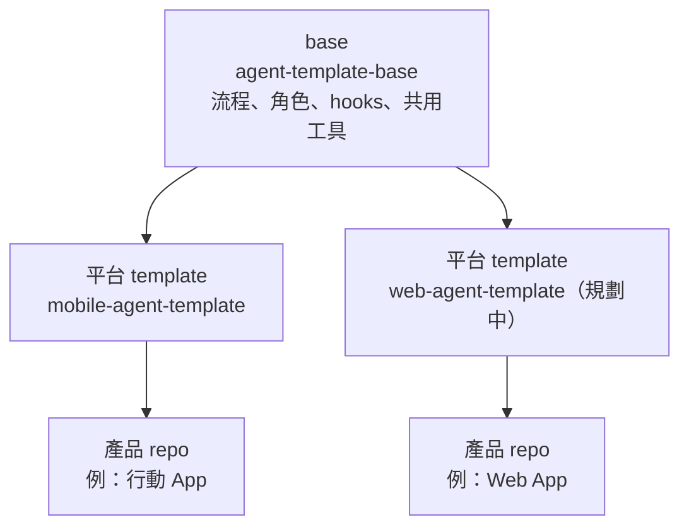

# Template 架構

流程與平台分層維護：一個平台一個 template，全部從同一個 base 衍生，並以 git 歷史保持關聯，base 的更新可以 merge 到每個平台 template。

## 三層



| 層 | Repo | 內容 |
| --- | --- | --- |
| base | `yimingc-1010/agent-template-base` | 平台無關的流程、角色 skill、hooks、GitHub 範本、文件範本、`packages/core` 範例 |
| 平台 template | `yimingc-1010/mobile-agent-template` 等 | `docs/platform.md`、平台應用程式、e2e 工具、release skill、平台專屬設定 |
| 產品 repo | 從平台 template 建立 | 產品需求、設計、程式碼 |

## 檔案所有權

**base 擁有**：平台 template 與產品 repo 不得修改；要改就在 base 修改，再同步下去。

| 類別 | 檔案 |
| --- | --- |
| 流程與 agent | `CLAUDE.md`、`docs/process.md`、`docs/template.md`、`.claude/skills/{pm,architect,implement,review,qa}/`、`.claude/agents/`、`.claude/hooks/` |
| GitHub | `.github/ISSUE_TEMPLATE/`、`.github/pull_request_template.md`、`scripts/setup-labels.sh` |
| 文件範本 | `docs/prd.md`、`docs/adr/000-template.md`、`docs/design/README.md`、`docs/agent-log.md`、`fixtures/README.md` |
| 共用程式與工具 | `packages/core/`、`.editorconfig`、`.prettierrc.json`、`.prettierignore`、`.nvmrc`、根目錄 `.gitignore` |

**平台擁有**：每個平台 template 必須提供（見下方檢查清單）。

**共用檔案**：base 提供初始版本，平台可以修改。修改盡量以「追加」為主，降低同步時的衝突。

`package.json`、`.claude/settings.json`、`.github/CODEOWNERS`、`README.md`

## 平台 template 必須提供

- [ ] `docs/platform.md`：章節對應 `docs/process.md` 中所有「見平台設定」之處（技術棧、程式碼位置、指令、測試配置、驗證分層、平台 labels、發布管道、人工驗收、正式發布前檢查、一次性設定、平台受保護路徑）
- [ ] `docs/adr/001-tech-stack.md`：平台技術選型
- [ ] `apps/<platform>/`：平台應用程式，含 service registry 與 fake 切換
- [ ] `e2e/`：e2e 工具設定與 smoke 測試 `us-00-*`
- [ ] `.claude/skills/release/SKILL.md`：預發布與正式發布準備
- [ ] `.claude/protected-paths.platform`：平台受保護路徑（每行一個 glob）
- [ ] `scripts/setup-labels.platform.sh`：平台特有 labels（沒有就不建立）
- [ ] `docs/qa/`：人工驗收腳本
- [ ] 根目錄 `package.json` 實作 script 契約

## Script 契約

skill、hook 與 CI 只呼叫以下名稱，不直接呼叫平台工具。換平台時只改實作。

| Script | 意義 |
| --- | --- |
| `npm run verify` | T1：typecheck + lint + 單元與元件測試 + format check |
| `npm run format` | 自動排版 |
| `npm run e2e` | 全部 e2e |
| `npm run e2e:one -- <file>` | 單一 e2e 檔案 |

## 同步 base 的更新

在平台 template（或保留關聯的產品 repo）中：

```bash
git remote add base git@github.com-yimingc1990:yimingc-1010/agent-template-base.git   # 只需一次
git fetch base
git merge base/main
```

衝突只應該出現在共用檔案。base 擁有的檔案若出現衝突，代表下游違規修改了它：以 base 版本為準，把下游的需求改成對 base 的修改提案。

## 建立新的平台 template

```bash
git clone git@github.com-yimingc1990:yimingc-1010/agent-template-base.git <name>
cd <name>
git remote rename origin base
gh repo create yimingc-1010/<name> --private
git remote add origin git@github.com-yimingc1990:yimingc-1010/<name>.git
# 加入「平台 template 必須提供」的檔案後 commit
git push -u origin main
gh repo edit yimingc-1010/<name> --template
```

## 從平台 template 建立產品 repo

| 方式 | 指令 | 能否同步 template 更新 |
| --- | --- | --- |
| 保留關聯（建議） | clone 平台 template → `git remote rename origin template` → 建立新 repo 並 push | 可以：`git fetch template && git merge template/main` |
| GitHub「Use this template」 | `gh repo create <name> --template <template>` | 不行：歷史不相連，更新只能手動移植 |

## 客製化工具

新增工具前，先決定它屬於哪一層：

| 適用範圍 | 放在 |
| --- | --- |
| 所有平台都需要 | base |
| 只有某個平台需要 | 該平台 template，並列在 `docs/platform.md` 的「選配工具」章節 |
| 只有某個產品需要 | 產品 repo |

命名規則，避免與上游衝突：

- Skill：`pm`、`architect`、`implement`、`review`、`qa` 保留給 base，`release` 保留給平台；自訂 skill 使用其他名稱。
- Workflow（`.github/workflows/`）：`agent-*.yml` 保留給 base，`ci-*.yml`、`release-*.yml` 保留給平台；自訂 workflow 使用 `x-*.yml`。
- Hook：新的 hook 腳本放在 `.claude/hooks/` 以外的路徑（例如 `scripts/hooks/`），再在 `.claude/settings.json` 註冊。
